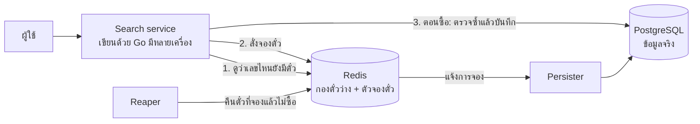

# ระบบค้นหาลอตเตอรี่ (Lottery Search System): เอกสารออกแบบ

> ส่วนที่ 2 ของโจทย์ เป็นงานออกแบบอย่างเดียว ไม่ต้องเขียนโค้ด

## สรุปสั้น ๆ

1. **ค้นหาเร็ว:** เลข 6 หลักมีแค่ 1 ล้านแบบ ระบบจึงไม่ต้องค้นตั๋วทั้ง 10 ล้านใบ แค่หาว่าเลขไหนเข้าเงื่อนไข แล้วข้ามเลขที่ขายหมด ใช้เวลาไม่เกิน 1 มิลลิวินาที
2. **ไม่มีตั๋วซ้ำ:** Redis เก็บตั๋วที่ยังว่างแยกตามเลข เวลามีคนค้น Redis จะหยิบตั๋วออกจากกองทันที ตั๋วใบที่ถูกหยิบไปแล้วจึงไม่มีทางไปถึงคนอื่น
3. **ไม่ขายซ้ำแม้ระบบพัง:** PostgreSQL เก็บข้อมูลจริงทั้งหมด และตรวจซ้ำอีกครั้งตอนกดซื้อ ถึง Redis จะล่ม ตั๋วก็ไม่ถูกขายให้สองคน

---

## 1. จุดที่ทำให้โจทย์นี้ง่ายกว่าที่คิด

ตั๋วมี 10 ล้านใบ แต่เลข 6 หลักมีแค่ **1 ล้านแบบ** (`000000` ถึง `999999`) แปลว่าเลขหนึ่งเลขมีตั๋วประมาณ 10 ใบ (มาจากหลายชุดหรือหลายงวด)

ยิ่งระบุตัวเลขมาก เลขที่เข้าเงื่อนไขก็ยิ่งน้อย:

| ผู้ใช้ค้น | ระบุตัวเลขกี่หลัก | เลขที่เข้าเงื่อนไข | ตัวอย่าง | จำนวนตั๋วโดยประมาณ |
|---|---|---|---|---|
| `123456` | 6 | 1 เลข | `123456` | ~10 ใบ |
| `123***` (ขึ้นต้น 123) | 3 | 1,000 เลข | `123000` ถึง `123999` | ~10,000 ใบ |
| `****23` (ลงท้าย 23) | 2 | 10,000 เลข | `000023`, `000123`, … `999923` | ~100,000 ใบ |
| `1****5` (ขึ้นต้น 1 ลงท้าย 5) | 2 | 10,000 เลข | `100005`, `100015`, … `199995` | ~100,000 ใบ |
| `******` (เลขอะไรก็ได้) | 0 | 1,000,000 เลข | ทุกเลข | 10,000,000 ใบ |

**ผลคือ:** แทนที่จะค้นข้อความในข้อมูล 10 ล้านแถว ระบบแค่นับเลขที่เข้าเงื่อนไขซึ่งมีไม่เกิน 1 ล้านเลข ทำได้เร็วมาก

---

## 2. ภาพรวมของระบบ



| ส่วน | ทำอะไร |
|---|---|
| **PostgreSQL** | เก็บข้อมูลจริงของตั๋ว การจอง และการขาย ถ้า Redis ข้อมูลหาย ก็สร้างใหม่จากที่นี่ได้ |
| **Redis** | เก็บกองตั๋วที่ยังว่าง และเป็นตัวจองตั๋ว คำสั่งจองทำงานทีละคำสั่งจนจบ ไม่มีคำสั่งอื่นแทรกได้ |
| **Search service** | รับคำค้นจากผู้ใช้ หาเลขที่เข้าเงื่อนไข แล้วสั่ง Redis จองตั๋ว |
| **Reaper** | ทำงานทุก 1 วินาที คืนตั๋วที่จองไว้แต่ไม่ซื้อจนหมดเวลา กลับเข้ากอง |

---

## 3. ข้อมูลเก็บไว้อย่างไร

**PostgreSQL** มีตารางเดียว เก็บตั๋วทุกใบ

```sql
CREATE TABLE tickets (
    id         integer PRIMARY KEY,
    number     char(6) NOT NULL,                  -- '457123'
    set_no     smallint NOT NULL,                 -- ชุดที่ 3
    status     text NOT NULL DEFAULT 'available', -- available (ว่าง) | held (ถูกจอง) | sold (ขายแล้ว)
    hold_id    uuid,                              -- รหัสการจอง
    held_until timestamptz                        -- จองไว้ถึงกี่โมง
);
```

**Redis** เก็บ 4 อย่าง

| ชื่อ | ชนิด | ตัวอย่าง | หมายความว่า |
|---|---|---|---|
| `inv:457123` | SET | `{40211, 40212, 40219}` | เลข 457123 ยังเหลือ 3 ใบ (เก็บรหัสตั๋ว) |
| `avail` | Bitmap | ช่องที่ 457123 = `1` | เลข 457123 ยังมีตั๋ว (`0` แปลว่าขายหมด) |
| `hold:h-91f2` | SET | `{40211}` | ตั๋วที่ผู้ใช้ A จองไว้ |
| `holds:exp` | ZSET | `h-91f2 → 10:05:00` | การจองของ A หมดเวลา 10:05 |

ทั้งหมดใช้หน่วยความจำประมาณ 200 MB ส่วน bitmap ใช้แค่ 125 KB

**ตั๋วหนึ่งใบอยู่ได้ที่เดียวเท่านั้น:** ถ้าไม่อยู่ในกองตั๋วว่าง (`inv:*`) ก็ต้องอยู่ในการจองของใครสักคน (`hold:*`) หรือไม่ก็ขายไปแล้ว ระบบดูแลให้เป็นแบบนี้เสมอ

---

## 4. ตัวอย่าง: ผู้ใช้ค้นหาและจองตั๋ว

สมมติผู้ใช้ A อยากได้เลขท้าย `23` (ค้นด้วย `****23`) จำนวน 3 ใบ ระบบจะทำงานแบบนี้

1. **หาเลขที่เข้าเงื่อนไข:** เลขที่ลงท้ายด้วย 23 มีทั้งหมด 10,000 เลข ตั้งแต่ `000023` ถึง `999923`
2. **สุ่มจุดเริ่ม:** เช่น เริ่มที่ `457123` แล้วไล่ต่อไปเป็น `458123`, `459123` คนอื่นที่ค้นเลขท้าย 23 พร้อมกันจะได้จุดเริ่มต่างกัน จึงไม่แย่งเลขเดียวกัน
3. **ข้ามเลขที่ขายหมดแล้ว:** ดูจาก bitmap เช่น `458123` ขายหมดแล้ว ก็ข้ามไปเลย
4. **ให้ Redis หยิบตั๋ว:** ส่งเลขชุดแรก 64 เลขให้ Redis ซึ่งจะหยิบตั๋วออกจากกองทีละใบจนครบ 3 ใบ
   ```
   SPOP inv:457123 → 40211   ✅
   SPOP inv:459123 → 40877   ✅
   SPOP inv:460123 → 41003   ✅  ครบ 3 ใบ หยุด
   SADD hold:h-91f2 40211 40877 41003
   ZADD holds:exp (ตอนนี้ + 5 นาที) h-91f2
   ```
5. **ส่งผลให้ผู้ใช้:** A เห็นตั๋ว 3 ใบนี้ และระบบกันไว้ให้ A คนเดียวเป็นเวลา 5 นาที จนกว่า A จะซื้อหรือยกเลิก

ถ้า bitmap ยังไม่อัปเดต ทำให้ได้ตั๋วไม่ครบ ระบบจะส่งเลข 64 เลขถัดไปให้ Redis หยิบต่อ bitmap มีไว้ช่วยให้เร็วขึ้นเท่านั้น ส่วนความถูกต้องมาจาก Redis

---

## 5. ทำไมจึงไม่มีตั๋วซ้ำ

**ตัวอย่างที่ 1: A กับ B ค้นเลขท้าย 23 พร้อมกัน แต่เลข `457123` เหลือใบเดียว**

| เวลา | A | B |
|---|---|---|
| 10:00:00.001 | Redis หยิบตั๋วจาก `inv:457123` ได้ `40211` | รอ (Redis ทำงานทีละคำสั่ง) |
| 10:00:00.002 | | Redis หยิบจาก `inv:457123` แต่กองว่างแล้ว จึงไปหยิบเลขถัดไป |
| ผลลัพธ์ | ได้ตั๋ว `40211` | ได้ตั๋วใบอื่น ไม่ซ้ำกับ A |

**ตัวอย่างที่ 2: ค้นคนละแบบ แต่เลขที่ได้ตรงกัน**

- A ค้นเลขขึ้นต้น 12 (`12****`) ส่วน B ค้นเลขท้าย 56 (`****56`) ทั้งสองคนค้นเจอเลข `123456`
- เลข `123456` เหลือ 2 ใบ A ได้ใบแรก B ได้ใบที่สอง
- C มาค้นเลขขึ้นต้น 123 (`123***`) เลข `123456` หมดแล้ว C จึงได้เลขอื่น

**เหตุผล:** คำสั่ง `SPOP` **หยิบตั๋วออกจากกองเลย** ไม่ได้แค่ดูว่ามีไหม และ Redis ทำงานทีละคำสั่งจนจบ จึงไม่มีจังหวะที่สองคนจะหยิบตั๋วใบเดียวกันได้ ตัวอย่างที่ 2 แสดงว่าระบบป้องกันได้ **มากกว่าที่โจทย์ขอ** เพราะโจทย์ขอแค่กรณีที่ค้นด้วยคำค้นเดียวกัน

---

## 6. การจองตั๋วตั้งแต่ค้นจนซื้อ

| เหตุการณ์ | ตัวอย่าง | ระบบทำอะไร |
|---|---|---|
| **ค้นหา** | A ค้นตอน 10:00 | จองตั๋วไว้ให้ 5 นาที (ถึง 10:05) |
| **ซื้อทันเวลา** | A กดซื้อตอน 10:03 | PostgreSQL ตรวจว่าตั๋วยังเป็นการจองของ A และยังไม่หมดเวลา แล้วเปลี่ยนสถานะเป็นขายแล้ว |
| **ซื้อไม่ทัน** | A กดซื้อตอน 10:06 | การจองหมดเวลาไปแล้ว ระบบแจ้งให้ค้นใหม่ |
| **ไม่ซื้อ** | A ปิดแอปไปเลย | ตอน 10:05 Reaper คืนตั๋วเข้ากอง คนอื่นค้นเจอได้อีก |
| **ค้นใหม่** | A เปลี่ยนไปค้นเลขอื่น | คืนตั๋วที่จองไว้เดิมก่อน (จองได้ทีละชุด) |

คำสั่งที่ใช้ตอนซื้อ ตรวจทุกอย่างในคำสั่งเดียว:

```sql
UPDATE tickets SET status = 'sold'
WHERE id IN (40211, 40877, 41003) AND hold_id = 'h-91f2' AND held_until > now();
```

**กันคนกักตั๋ว:** จองได้ไม่เกิน 10 ใบต่อครั้ง หนึ่งคนจองได้ทีละชุด และจำกัดจำนวนครั้งที่ค้นได้ต่อนาที

---

## 7. ทำไมเลือก Redis คู่กับ PostgreSQL

| ทางเลือก | ค้นเลขท้าย 23 ได้เร็วไหม | กันตั๋วซ้ำได้ไหม | สรุป |
|---|---|---|---|
| SQL `LIKE '%23'` | ❌ ช้า index ช่วยได้แค่การค้นเลขขึ้นต้น | ✅ ได้ | ใช้กับการค้นบางแบบไม่ได้ |
| แยกเก็บทีละหลัก + index | △ พอได้ แต่ใช้เวลาหลายสิบมิลลิวินาที | ✅ ได้ | ใช้ได้ แต่ขยายระบบยาก |
| Elasticsearch | △ การค้นแบบนี้ค่อนข้างช้า | ❌ ไม่มีวิธีจองที่ปลอดภัยในตัว | ใหญ่เกินความจำเป็น |
| **Redis + PostgreSQL** | ✅ ไม่เกิน 1 มิลลิวินาที | ✅ ได้ | **เลือกแบบนี้** |

**ถ้าคนใช้ยังไม่เยอะ ใช้ PostgreSQL อย่างเดียวก็ได้** (เหมาะกับการค้นหลักร้อยครั้งต่อวินาที)

```sql
WITH picked AS (
  SELECT id FROM tickets
  WHERE status = 'available' AND number LIKE '____23'   -- แปลง * เป็น _
  LIMIT 3
  FOR UPDATE SKIP LOCKED      -- ข้ามแถวที่คนอื่นกำลังจองอยู่ จึงไม่ได้ตั๋วซ้ำ
)
UPDATE tickets SET status = 'held', hold_id = $1, held_until = now() + interval '5 min'
FROM picked WHERE tickets.id = picked.id
RETURNING tickets.id, tickets.number;
```

- **ข้อดี:** มีระบบเดียว ดูแลง่าย และกันตั๋วซ้ำได้เหมือนกัน
- **ข้อเสีย:** การค้นเลขท้ายต้องอ่านข้อมูลเยอะ และถ้าคนแย่งเลขเดียวกันมาก ๆ จะต้องรอคิวกัน
- **แนะนำ:** เริ่มจากแบบนี้ก่อน พอคนใช้เยอะขึ้นค่อยเพิ่ม Redis โดยไม่ต้องเปลี่ยน API

---

## 8. เร็วแค่ไหน (ตัวเลขโดยประมาณ)

| ผู้ใช้ค้น | เลขที่ต้องไล่ดู | เวลาที่ใช้ | เรียก Redis |
|---|---|---|---|
| `123456` | 1 เลข | แทบไม่ใช้เวลา | 1 ครั้ง |
| `123***` | 1,000 เลข | ไม่กี่ไมโครวินาที | 1 ครั้ง |
| `****23` | 10,000 เลข | ราว 10 ไมโครวินาที | 1 ครั้ง |
| `******` | 1,000,000 เลข | ไม่เกิน 1 มิลลิวินาที | 1 ครั้ง |

- **การจองหนึ่งครั้ง:** ใช้เวลาหลายสิบไมโครวินาที Redis เครื่องเดียวรับได้ราว 20,000–50,000 การจองต่อวินาที
- **เวลาตอบผู้ใช้:** ฝั่ง server ใช้ราว 1–3 มิลลิวินาที ส่วนใหญ่เป็นเวลาที่ข้อมูลวิ่งผ่าน network
- **ถ้าต้องรับคนมากกว่านี้:** แบ่ง Redis เป็นหลายเครื่องตามเลข 2 หลักท้าย การค้นเลขท้ายจะวิ่งไปเครื่องเดียว

---

## 9. ถ้าระบบมีปัญหา

| ปัญหา | ตัวอย่าง | ผลกระทบและวิธีรับมือ |
|---|---|---|
| Redis ล่ม | การจองล่าสุดหายไปไม่เกิน 1 วินาที | ตั๋วอาจโชว์ให้คนอื่นเห็นซ้ำชั่วครู่ แต่ **ขายซ้ำไม่ได้** เพราะ PostgreSQL ตรวจตอนซื้อ จากนั้นสร้างข้อมูลใน Redis ใหม่จาก PostgreSQL |
| ข้อมูลสองที่ไม่ตรงกัน | Persister บันทึกการจองไม่สำเร็จ | สั่งบันทึกซ้ำได้โดยไม่เกิดข้อมูลซ้ำ และมีงานตรวจยอดให้ตรงกันทุกคืน |
| bitmap ไม่อัปเดต | ระบบคิดว่ามีตั๋ว แต่จริง ๆ หมดแล้ว | ส่งให้ Redis หยิบเลขถัดไป ช้าลงนิดเดียว ไม่กระทบความถูกต้อง |
| คนแย่งเลขเด็ด | หลายพันคนค้นเลขท้าย 99 พร้อมกัน | ทุกคนเริ่มจากจุดสุ่มต่างกัน จึงกระจายไปคนละเลข ไม่ต้องรอคิว |
| เลขยาวขึ้นเป็น 8–10 หลัก | เลขที่ต้องไล่ดูมากเกินไป | เปลี่ยนวิธีหาเลขเป็นการใช้ bitmap แยกตามหลัก ส่วนวิธีจองตั๋วใช้แบบเดิมได้ |
