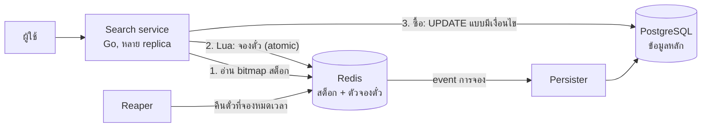

# ระบบค้นหาลอตเตอรี่ (Lottery Search System): เอกสารออกแบบ

> ส่วนที่ 2 ของโจทย์ เป็นงานออกแบบอย่างเดียว ไม่มีโค้ด

## สรุปใน 3 บรรทัด

1. **ค้นหา:** เลข 6 หลักมีแค่ 1 ล้านแบบ จึงไม่ต้องค้นในตั๋ว 10 ล้านใบ แค่ไล่สร้างเลขที่ตรง pattern แล้วข้ามเลขที่ขายหมด ใช้เวลาไม่เกิน ~1 ms
2. **กันซ้ำ:** Redis เก็บตั๋วว่างของแต่ละเลขเป็น SET แล้วใช้ Lua script `SPOP` หยิบตั๋วออกแบบ atomic ตั๋วที่ถูกหยิบไปแล้วจึงไม่มีทางไปถึงคนที่สอง
3. **ความถูกต้อง:** PostgreSQL เป็นข้อมูลหลัก ตอนซื้อจริงมี `UPDATE` แบบมีเงื่อนไขเป็นด่านที่สอง ถ้า Redis ล่ม ตั๋วก็ยังขายซ้ำไม่ได้

---

## 1. ข้อสังเกตที่ทำให้โจทย์ง่ายลง

ตั๋วมี 10 ล้านใบ แต่เลข 6 หลักมีแค่ **1 ล้านแบบ** (`000000`–`999999`) เฉลี่ยเลขละ ~10 ใบ (หลายชุด หลายงวด)

pattern ที่กำหนดตัวเลขไว้ *k* หลัก จะตรงกับเลขพอดี **10⁶⁻ᵏ เลข**:

| Pattern | กำหนดไว้ (k) | เลขที่ตรง | ตัวอย่างเลขที่ตรง | ตั๋วโดยประมาณ |
|---|---|---|---|---|
| `123456` | 6 | 1 | `123456` | ~10 |
| `123***` | 3 | 1,000 | `123000`, `123001`, …, `123999` | ~10,000 |
| `****23` | 2 | 10,000 | `000023`, `000123`, …, `999923` | ~100,000 |
| `1****5` | 2 | 10,000 | `100005`, `100015`, …, `199995` | ~100,000 |
| `******` | 0 | 1,000,000 | ทุกเลข | 10,000,000 |

**ผลคือ:** การค้นหาไม่ใช่การค้นข้อความใน 10 ล้านแถว แต่เป็น **การนับเลขในพื้นที่ขนาด 1 ล้านช่อง** ซึ่งเร็วมาก

---

## 2. สถาปัตยกรรม



| ส่วน | หน้าที่ |
|---|---|
| **PostgreSQL** | ข้อมูลหลักของตั๋ว การจอง และการขาย ถ้า Redis หาย สร้างใหม่จากที่นี่ได้ |
| **Redis** | สต็อกที่ใช้บ่อย + ตัวจองตั๋ว Lua script รันทีละคำสั่ง ไม่มีใครแทรกได้ |
| **Search service** | แปลง pattern เป็นเลข เรียก Lua จองตั๋ว ไม่เก็บ state |
| **Reaper** | ทุก 1 วินาที คืนตั๋วที่จองแล้วไม่ซื้อจนหมดเวลา |

---

## 3. เก็บข้อมูลอย่างไร (พร้อมตัวอย่างค่าจริง)

**PostgreSQL**

```sql
CREATE TABLE tickets (
    id         integer PRIMARY KEY,
    number     char(6) NOT NULL,                -- '457123'
    set_no     smallint NOT NULL,               -- ชุดที่ 3
    status     text NOT NULL DEFAULT 'available', -- available | held | sold
    hold_id    uuid,
    held_until timestamptz
);
```

**Redis**

| Key | ชนิด | ตัวอย่างค่า | ความหมาย |
|---|---|---|---|
| `inv:457123` | SET | `{40211, 40212, 40219}` | เลข 457123 ยังเหลือ 3 ใบ (เก็บ id ตั๋ว) |
| `avail` | Bitmap 1 ล้านบิต | บิตที่ 457123 = `1` | เลขนี้ยังมีตั๋ว (`0` = ขายหมด) |
| `hold:h-91f2` | SET | `{40211}` | การจองของผู้ใช้ A |
| `holds:exp` | ZSET | `h-91f2 → 10:05:00` | การจองนี้หมดเวลาตอนไหน |

ใช้หน่วยความจำรวม ~200 MB ส่วน bitmap มีขนาดแค่ 125 KB

**กฎที่ต้องจริงเสมอ:** ตั๋วแต่ละใบอยู่ **ที่เดียวเท่านั้น** คือใน `inv:*` หรือใน `hold:*` อันใดอันหนึ่ง หรือขายแล้วใน PostgreSQL

---

## 4. ตัวอย่าง: ผู้ใช้ค้นหาและจองตั๋ว

สมมติผู้ใช้ A อยากได้เลขท้าย `23` (ค้นด้วย `****23`) จำนวน 3 ใบ ระบบจะทำงานแบบนี้

1. **หาเลขที่เข้าเงื่อนไข:** เลขที่ลงท้ายด้วย 23 มีทั้งหมด 10,000 เลข ตั้งแต่ `000023` ถึง `999923`
2. **สุ่มจุดเริ่ม:** เช่น เริ่มที่ `457123` แล้วไล่ต่อไปเป็น `458123`, `459123` คนอื่นที่ค้นเลขท้าย 23 พร้อมกันจะได้จุดเริ่มต่างกัน จึงไม่แย่งเลขเดียวกัน
3. **ข้ามเลขที่ขายหมดแล้ว:** ดูจาก bitmap เช่น `458123` ขายหมดแล้ว ก็ข้ามไปเลย
4. **ให้ Redis หยิบตั๋ว:** ส่งเลขชุดแรก 64 เลขให้ Lua script ซึ่งจะหยิบตั๋วออกทีละใบจนครบ 3 ใบ
   ```
   SPOP inv:457123 → 40211   ✅
   SPOP inv:459123 → 40877   ✅
   SPOP inv:460123 → 41003   ✅  ครบ 3 ใบ หยุด
   SADD hold:h-91f2 40211 40877 41003
   ZADD holds:exp (ตอนนี้ + 5 นาที) h-91f2
   ```
5. **ส่งผลให้ผู้ใช้:** A เห็นตั๋ว 3 ใบนี้ และระบบกันไว้ให้ A คนเดียวเป็นเวลา 5 นาที จนกว่า A จะซื้อหรือยกเลิก

ถ้า bitmap ยังไม่อัปเดต ทำให้ได้ตั๋วไม่ครบ ระบบจะส่งเลข 64 เลขถัดไปให้ Redis หยิบต่อ bitmap มีไว้ช่วยให้เร็วขึ้นเท่านั้น ส่วนความถูกต้องมาจาก Redis

---

## 5. ทำไมตั๋วซ้ำเกิดขึ้นไม่ได้

**ตัวอย่าง 1: A และ B ค้น `****23` พร้อมกัน แต่เลข `457123` เหลือใบเดียว**

| เวลา | A | B |
|---|---|---|
| 10:00:00.001 | Lua: `SPOP inv:457123` → ได้ `40211` | รอ (Redis รัน script ทีละตัว) |
| 10:00:00.002 | | Lua: `SPOP inv:457123` → **ว่าง** ไปเลขถัดไป |
| ผล | ได้ `40211` | ได้ตั๋วใบอื่น ไม่ซ้ำกับ A |

**ตัวอย่าง 2: คนละ pattern แต่ตั๋วทับกัน**

- A ค้น `12****` ส่วน B ค้น `****56` ทั้งคู่ตรงกับเลข `123456`
- `inv:123456` เหลือ 2 ใบ → A ได้ใบแรก B ได้ใบที่สอง
- C มาค้น `123***` → `123456` ว่างแล้ว ไปเลขอื่น

**สรุป:** `SPOP` **ดึงตั๋วออกจาก SET** ไม่ใช่แค่อ่าน และ Redis รัน Lua script จบทีละตัว จึงไม่มีจังหวะที่สองคนหยิบใบเดียวกันได้ ตัวอย่าง 2 แสดงว่าระบบกันได้ **มากกว่าที่โจทย์ขอ** (โจทย์ขอแค่ pattern เดียวกัน)

---

## 6. วงจรชีวิตของการจอง

| เหตุการณ์ | ตัวอย่าง | สิ่งที่ระบบทำ |
|---|---|---|
| **ค้นหา** | A ค้นตอน 10:00 | จองไว้ 5 นาที (ถึง 10:05) |
| **ซื้อ** | A กดซื้อตอน 10:03 | PostgreSQL: `UPDATE tickets SET status='sold' WHERE id IN (…) AND hold_id='h-91f2' AND held_until > now()` แล้วลบการจองใน Redis |
| **ซื้อช้าไป** | A กดซื้อตอน 10:06 | `held_until` เลยมาแล้ว UPDATE ไม่เจอแถว → แจ้งว่าการจองหมดเวลา |
| **ไม่ซื้อ** | A ปิดแอปไป | 10:05 reaper คืนตั๋วเข้า `inv:*` และตั้ง bitmap เป็น `1` |
| **ค้นใหม่** | A ค้น pattern ใหม่ | คืนการจองเดิมก่อน (1 คนจองได้ทีละชุด) |

**กันกักตั๋ว:** จองได้สูงสุด 10 ใบต่อครั้ง 1 การจองต่อคน และจำกัดจำนวนการค้นต่อนาที

---

## 7. ทำไมเลือก Redis + PostgreSQL

| ทางเลือก | ค้น `****23` ได้เร็วไหม | กันซ้ำได้ไหม | สรุป |
|---|---|---|---|
| SQL `LIKE '%23'` | ❌ index ช่วยได้แค่แบบขึ้นต้น `123%` | ✅ `SKIP LOCKED` | ไม่ครอบคลุม pattern |
| แยกคอลัมน์ทีละหลัก + index | △ ต้องรวม bitmap ขนาดใหญ่ หลายสิบ ms | ✅ | ใช้ได้ แต่ขยายระบบยาก |
| Elasticsearch | △ wildcard ช้า | ❌ ไม่มีการจองแบบ atomic | เกินจำเป็น |
| **Redis + PostgreSQL** | ✅ ≤ ~1 ms | ✅ `SPOP` atomic | **เลือกแบบนี้** |

**ทางเลือกที่ง่ายกว่า: ใช้ PostgreSQL อย่างเดียว** (เหมาะกับ traffic ไม่สูง เช่น หลักร้อยการค้นต่อวินาที)

```sql
WITH picked AS (
  SELECT id FROM tickets
  WHERE status = 'available' AND number LIKE '____23'   -- แปลง * เป็น _
  LIMIT 3
  FOR UPDATE SKIP LOCKED      -- ข้ามแถวที่คนอื่นกำลังล็อก → ไม่ได้ตั๋วซ้ำ
)
UPDATE tickets SET status = 'held', hold_id = $1, held_until = now() + interval '5 min'
FROM picked WHERE tickets.id = picked.id
RETURNING tickets.id, tickets.number;
```

- **ข้อดี:** มีระบบเดียว และกันซ้ำได้เหมือนกัน
- **ข้อเสีย:** pattern แบบ `****23` ต้องสแกนเยอะ และ pattern ยอดนิยมจะแย่ง lock กัน
- **คำแนะนำ:** เริ่มจากแบบนี้เป็นเฟสแรก แล้วย้ายไป Redis ทีหลังได้โดยไม่ต้องเปลี่ยน API

---

## 8. ประสิทธิภาพ (ตัวเลขประมาณ)

| Pattern | เลขที่ต้องไล่ | เวลาไล่ใน Go | เรียก Redis |
|---|---|---|---|
| `123456` | 1 | ทันที | 1 ครั้ง |
| `123***` | 1,000 | ~µs | 1 ครั้ง |
| `****23` | 10,000 | ~10 µs | 1 ครั้ง |
| `******` | 1,000,000 | ≤ ~1 ms | 1 ครั้ง |

- **Lua script หนึ่งครั้ง:** (64 เลข) ใช้หลายสิบ µs Redis ตัวเดียวรองรับได้ราว 20,000–50,000 การจองต่อวินาที
- **เวลาตอบรวม:** ฝั่ง server ราว 1–3 ms ส่วนใหญ่เป็นเวลาเดินทางของ network
- **ถ้าต้องขยายต่อ:** ใช้ Redis Cluster แบ่ง shard ตามเลข 2 หลักท้าย pattern ที่กำหนดเลขท้ายไว้จะไปถึง shard เดียว

---

## 9. ถ้าระบบพัง

| เหตุการณ์ | ตัวอย่าง | ผลกระทบ / วิธีรับมือ |
|---|---|---|
| Redis ล่ม | การจองล่าสุดหายไม่เกิน 1 วินาที | ตั๋วอาจถูกโชว์ซ้ำชั่วครู่ แต่ **ขายซ้ำไม่ได้** เพราะ PostgreSQL เช็กตอนซื้อ แล้วสร้างสต็อกใหม่จาก PostgreSQL |
| Redis กับ PostgreSQL ไม่ตรงกัน | persister ส่ง event ไม่สำเร็จ | persister รันซ้ำได้ปลอดภัย (ใช้ `hold_id`) และมีงานกระทบยอดทุกคืน |
| Bitmap ในเครื่องเก่า | เห็นว่ามีตั๋ว แต่จริง ๆ หมดแล้ว | เรียก Lua เพิ่มอีกรอบ ไม่กระทบความถูกต้อง |
| เลข "เด็ด" คนแย่งกัน | หลายพันคนค้น `****99` | เริ่มจากจุดสุ่ม ทุกคนจึงกระจายไปคนละเลข ไม่ต้องรอ lock |
| เลขยาวขึ้นเป็น 8–10 หลัก | ไล่สร้าง 10⁸ เลขไม่ไหว | เปลี่ยนเป็น Roaring bitmap ต่อหลักต่อตัวเลข แล้ว intersect ตัวจองตั๋วใช้แบบเดิมได้ |
