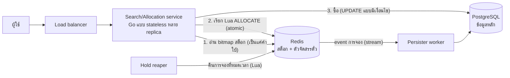

# ระบบค้นหาลอตเตอรี่ (Lottery Search System): เอกสารออกแบบ

## 1. ทวนโจทย์

- มีตั๋ว **10 ล้านใบ** แต่ละใบมี **เลข 6 หลัก** (`000000`–`999999`)
- ผู้ใช้ค้นหาด้วย pattern 6 ตัวอักษร ประกอบด้วยตัวเลขและ `*` (เช่น `****23`, `1****5`, `123***`) แล้วได้ตั๋วที่ตรงกลับไป
- **ตั๋วใบเดียวกันต้องไม่ถูกส่งให้ผู้ใช้สองคนในเวลาเดียวกัน**
- ระบบต้องเร็วที่ระดับ 10 ล้านแถวขึ้นไป ใช้ storage ที่เหมาะกับ production และจัดการ concurrency ได้ถูกต้อง

### ข้อสังเกตที่เป็นหัวใจของการออกแบบ

เลข 6 หลักมีได้แค่ **10⁶ = 1 ล้านแบบ** แต่ตั๋วมี **10⁷ = 10 ล้านใบ** แปลว่าเลขหนึ่งเลขมีตั๋วซ้ำกันประมาณ 10 ใบ (หลายชุด หลายงวด หรือหลายล็อต) ตั๋วหนึ่งใบจึงเท่ากับ `(เลข, ชุด)`

ข้อนี้เปลี่ยนการค้นหาด้วย wildcard จากปัญหา "ค้นข้อความ" ให้เป็น **การไล่นับในพื้นที่ข้อมูลขนาดเล็ก**

- pattern ที่มีตัวเลขกำหนดไว้ *k* หลัก จะตรงกับเลขพอดี **10⁶⁻ᵏ เลข**
- เลขทุกตัวใส่ลง array หรือ bitmap ขนาด 1,000,000 ช่องได้ (ถ้าเก็บเป็นบิตก็แค่ 125 KB)

เราจึงไม่ต้อง *ค้นหา* ใน 10 ล้านแถวเลย แค่ไล่สร้างเลขที่ตรง pattern ข้ามเลขที่ขายหมดแล้ว แล้ว **หยิบตั๋วออกจากสต็อกแบบ atomic** (ทำทีเดียวจบ ไม่มีใครแทรกได้)

## 2. สถาปัตยกรรม



| ส่วนประกอบ | หน้าที่ |
| --- | --- |
| **PostgreSQL** | ข้อมูลหลัก (source of truth) ของตั๋ว การจอง และการขาย การซื้อเป็นแบบ ACID เก็บประวัติตรวจสอบย้อนหลังได้ และใช้สร้างข้อมูลใน Redis ใหม่ได้ทั้งหมด |
| **Redis** (primary + replica, AOF `everysec`) | เก็บสต็อกที่ใช้งานบ่อยและเป็น **ตัวจัดสรรตั๋วแบบ atomic** Lua script ทำงาน thread เดียวและทำทีเดียวจบ จึงรับประกันได้ว่าไม่มีตั๋วซ้ำ |
| **Search/Allocation service** | ไม่เก็บ state แปลง pattern ไล่สร้างเลขที่ตรง เรียกตัวจัดสรร แล้วคืนตั๋วที่จองได้ |
| **Hold reaper** | ทำงานทุก 1 วินาที คืนตั๋วจากการจองที่หมดเวลากลับเข้าสต็อก |
| **Persister** | อ่าน event การจองและการคืนตั๋วจาก Redis Stream แล้วบันทึกลง PostgreSQL (แบบ outbox) |

## 3. โครงสร้างข้อมูล

### PostgreSQL (ข้อมูลหลัก)

```sql
CREATE TABLE tickets (
    id          integer     PRIMARY KEY,           -- 10 ล้านใส่ใน int32 ได้
    draw_id     integer     NOT NULL,              -- งวด
    number      char(6)     NOT NULL,              -- '000123'
    set_no      smallint    NOT NULL,              -- ชุดที่
    status      text        NOT NULL DEFAULT 'available'
                CHECK (status IN ('available', 'held', 'sold')),
    hold_id     uuid,
    held_until  timestamptz,
    sold_to     bigint,
    sold_at     timestamptz,
    UNIQUE (draw_id, number, set_no)
);
CREATE INDEX tickets_hold_idx ON tickets (hold_id) WHERE hold_id IS NOT NULL;
```

### Redis (สต็อกที่ใช้งานบ่อย)

| Key | ชนิด | เก็บอะไร | ขนาด |
| --- | --- | --- | --- |
| `inv:{เลข}` | SET ของตัวเลข | ID ของตั๋วเลขนั้นที่ **ยังว่าง** | ไม่เกิน 1 ล้าน key, key ละประมาณ 10 ID เก็บแบบ intset |
| `avail` | Bitmap 1 ล้านบิต | บิตที่ *n* เป็น 1 ก็ต่อเมื่อ `inv:n` ยังมีตั๋ว | 125 KB |
| `hold:{holdId}` | SET | ID ตั๋วในการจองนี้ (TTL = เวลาจอง + ช่วงเผื่อ) | เล็ก |
| `holds:exp` | ZSET | `holdId → เวลาหมดอายุ (ms)` ให้ reaper ใช้ | เล็ก |

หน่วยความจำโดยประมาณ: SET เล็ก ๆ ราว 1 ล้านตัว ตัวละ 100–200 B รวม **~150–250 MB** Redis เครื่องเดียวรับได้สบาย

**กฎที่ต้องเป็นจริงเสมอ (invariant):** ID ตั๋วทุกใบอยู่ **ที่เดียวเท่านั้น** คือใน `inv:*` หรือใน `hold:*` ใดหนึ่ง หรือถูกขายแล้วใน PostgreSQL การย้าย ID ระหว่างที่เหล่านี้ทำผ่าน Lua script เท่านั้น และแต่ละ script ทำงานแบบ atomic

## 4. อัลกอริทึมการค้นหาและจัดสรรตั๋ว

### 4.1 แปลง pattern เป็นเลขที่ตรง

1. ตรวจ pattern ด้วย `^[0-9*]{6}$`
2. สร้างรายการตัวเลือกของแต่ละหลัก หลักที่กำหนดตัวเลขไว้มีตัวเลือกเดียว หลักที่เป็น `*` มีตัวเลือก `0–9`
3. **ไล่สร้าง** เลขที่ตรงแบบหมุนเลขมิเตอร์ (odometer) เฉพาะหลักที่เป็น `*` โดยเริ่มจาก **ตำแหน่งสุ่ม** และกระโดดทีละระยะแบบสุ่ม ผลที่ได้คือ
   - ผู้ใช้หลายคนที่ค้น pattern เดียวกันพร้อมกันจะเริ่มคนละจุด แย่งตั๋วชุดเดียวกันน้อยลง
   - ผลลัพธ์กระจายแบบสุ่มและยุติธรรม ไม่ใช่ทุกคนได้ `000023` ก่อนเสมอ
4. **กรอง** ด้วย bitmap สต็อก service แต่ละ replica เก็บสำเนา `avail` ไว้ในเครื่อง (125 KB รีเฟรชทุก ~500 ms หรือผ่าน keyspace notification) สำเนานี้เป็นแค่ **คำใบ้** ไว้ข้ามเลขที่ขายหมดแล้ว ความถูกต้องไม่ได้ขึ้นกับมันเลย

### 4.2 จัดสรรตั๋วแบบ atomic (หัวใจของการกันตั๋วซ้ำ)

service ส่งเลขที่ตรงชุดถัดไป (เช่นครั้งละ 64 เลข) เข้า Lua script:

```
ALLOCATE(holdId, userId, want, ttl, candidates...):
    taken = []
    for n in candidates:
        while len(taken) < want:
            id = SPOP inv:{n}             -- ดึงตั๋วออกจากสต็อก
            if id == nil: break
            SADD hold:{holdId} id
            taken.append(id)
        if SCARD inv:{n} == 0: SETBIT avail n 0
        if len(taken) == want: break
    if taken: ZADD holds:exp now+ttl holdId; EXPIRE hold:{holdId} ttl+grace
              XADD hold-events * type held hold holdId user userId ids taken
    return taken
```

ถ้าเลขชุดนี้ให้ตั๋วไม่ครบ `want` ใบ (เพราะ bitmap ในเครื่องยังไม่อัปเดต) service จะเรียก script อีกครั้งด้วยเลขชุดถัดไป การเรียกแต่ละครั้งเป็น atomic และ invariant ยังคงเป็นจริงข้ามทุกครั้ง

**ทำไมตั๋วซ้ำเกิดขึ้นไม่ได้:**

- Redis รัน Lua script ตั้งแต่ต้นจนจบโดยไม่มีคำสั่งอื่นแทรกเข้ามาได้
- `SPOP` *ดึง ID ออก* จาก SET ผู้เรียกสองคนที่ทำพร้อมกันจึงไม่มีทางได้ ID เดียวกัน ไม่ว่าจะค้น pattern เดียวกันหรือคนละ pattern ที่ทับซ้อนกัน

การรับประกันนี้ **แข็งแรงกว่าที่โจทย์ขอ** เพราะ pattern ที่ทับซ้อนกันอย่าง `12****` กับ `****56` มีตั๋วร่วมกันได้ (`123456`) และกรณีนั้นก็ได้รับการป้องกันด้วย

### 4.3 วงจรชีวิตของการจอง

| เหตุการณ์ | สิ่งที่ทำ |
| --- | --- |
| **ค้นหา** | สร้างการจอง (TTL เช่น 5 นาที) ผู้ใช้เห็นตั๋ว *ชุดนี้* และไม่มีใครเห็นตั๋วชุดนี้อีก |
| **ซื้อ** | transaction ใน PostgreSQL: `UPDATE tickets SET status='sold', sold_to=$u WHERE id = ANY($ids) AND hold_id = $hold AND held_until > now()` จากนั้น `DEL hold:{id}` และ `ZREM holds:exp` ถ้าจำนวนแถวที่อัปเดตไม่เท่าจำนวนตั๋ว ให้ยกเลิกและแจ้งผู้ใช้ |
| **ยกเลิก / ค้นใหม่** | script `RELEASE(holdId)`: `SADD inv:{n}` คืนทีละ ID แล้ว `SETBIT avail n 1` |
| **หมดเวลา** | reaper รัน `ZRANGEBYSCORE holds:exp -inf now LIMIT 500` แล้ว `RELEASE` ทีละการจอง รัน reaper หลายตัวพร้อมกันได้ เพราะ `RELEASE` เช็กใน script ว่าการจองนั้นยังอยู่ |

`UPDATE` แบบมีเงื่อนไขใน PostgreSQL เป็น **ด่านป้องกันชั้นที่สอง** ที่แยกเป็นอิสระ ถึงข้อมูลใน Redis จะหายไป ตั๋วก็ถูกขายซ้ำไม่ได้

### 4.4 กันการกักตุนและความยุติธรรม

- จำกัดจำนวนตั๋วต่อการจอง (เช่นไม่เกิน 10 ใบ) และจำนวนการจองที่ค้างอยู่ต่อผู้ใช้ (เช่น 1 รายการ) เมื่อค้นใหม่ การจองเดิมจะถูกคืน จึงไม่มีใครกักตุนตั๋วได้
- จำกัดความถี่การค้นต่อผู้ใช้และต่อ IP ด้วย token bucket ใน Redis
- ผลลัพธ์เป็นแบบสุ่ม pattern เลขเด็ดยอดนิยมอย่าง `****99` จึงไม่ไปแย่งกันอยู่ที่เลขไม่กี่ตัว

## 5. ทำไมเลือก storage นี้ (ทางเลือกที่พิจารณา)

| ทางเลือก | ค้นด้วย wildcard | จัดสรรแบบไม่ซ้ำ | สรุป |
| --- | --- | --- | --- |
| **B-tree + `LIKE '123%'`** (SQL ทั่วไป) | ได้เฉพาะขึ้นต้น `****23` หรือ `1****5` ใช้ index ไม่ได้ | `FOR UPDATE SKIP LOCKED` | ✗ ไม่ครอบคลุม pattern |
| **generated column 6 หลัก + index แยกแต่ละหลัก** (PostgreSQL) | ใช้ BitmapAnd ของหลาย index แต่เงื่อนไขหลักเดียวตรงประมาณ 1 ล้านแถว จึงมี bitmap ขั้นกลางขนาดใหญ่ (หลายสิบ ms) | `SKIP LOCKED` | △ ใช้ได้ แต่ขยายระบบได้ไม่ดี |
| **Elasticsearch / trigram** | wildcard query บน keyword ช้า ส่วน trigram ใช้กับตัวเลขไม่ได้ผล | ไม่มีการจองแบบ atomic ต้องพึ่งระบบที่สอง | ✗ เกินความจำเป็น และ consistency อ่อน |
| **MongoDB** | ข้อจำกัดเรื่อง index เหมือน SQL | `findOneAndUpdate` ได้ทีละ document | △ |
| **Redis (ไล่สร้างเลข + SET ต่อเลข) + PostgreSQL** | **ตรวจบิต O(10⁶⁻ᵏ) กรณีแย่สุดไม่เกิน ~1 ms** | **Lua `SPOP` แบบ atomic ไม่ซ้ำโดยโครงสร้าง** | ✅ **เลือกแบบนี้** |

เหตุผลที่เลือก:

- **ประสิทธิภาพ:** ทำงานในหน่วยความจำ ใช้งาน O(1) ต่อเลขหนึ่งตัว และ latency ต่ำกว่า 1 ms สำหรับ pattern ทั่วไป
- **Concurrency:** script ทำงาน thread เดียวแบบ atomic จึงไม่ต้องจัดการ lock ไม่มี deadlock และไม่เกิดการ retry ถล่มกัน
- **ดูแลง่าย:** ใช้สองระบบที่คนใช้กันแพร่หลาย และมีแบบ managed service ให้ทั้งคู่ (ElastiCache/Memorystore, RDS/Cloud SQL) Redis เก็บแค่ข้อมูลที่สร้างใหม่จาก PostgreSQL ได้ ถ้าหายก็สร้างใหม่ได้ภายในประมาณ 1 นาทีด้วย `SADD` แบบ pipeline จาก 10 ล้านแถว

### ทางเลือกที่ง่ายกว่า: ใช้ PostgreSQL อย่างเดียว

ถ้า traffic ไม่สูง (ไม่เกินหลักร้อยการค้นต่อวินาที) PostgreSQL ตัวเดียวก็พอ:

```sql
-- partial index เฉพาะตั๋วที่ยังว่าง ทำให้ชุดข้อมูลที่ต้องสแกนเล็กลง
CREATE INDEX ON tickets (number text_pattern_ops)        WHERE status = 'available'; -- pattern ขึ้นต้น
CREATE INDEX ON tickets (reverse(number) text_pattern_ops) WHERE status = 'available'; -- pattern ลงท้าย

WITH picked AS (
  SELECT id FROM tickets
  WHERE status = 'available' AND number LIKE $1          -- '1____5' (แปลง '*' เป็น '_')
  LIMIT 10
  FOR UPDATE SKIP LOCKED                                 -- การค้นที่เกิดพร้อมกันจะข้ามแถวที่อีกฝ่ายล็อกไว้
)
UPDATE tickets t SET status = 'held', hold_id = $2, held_until = now() + interval '5 min'
FROM picked WHERE t.id = picked.id
RETURNING t.id, t.number, t.set_no;
```

- **ข้อดี:** มีระบบเดียว และ `SKIP LOCKED` รับประกันการไม่ซ้ำได้เหมือนกัน
- **ข้อเสีย:** pattern ที่กำหนดตัวเลขไว้เฉพาะตรงกลาง (`**3***`) ใช้ index ทั้งสองตัวไม่ได้ ต้องสแกน index ของตั๋วที่ว่างทั้งหมด และ pattern ยอดนิยมจะแย่ง row lock กัน

แบบนี้เหมาะเป็น *เฟสแรก* แล้วค่อยย้ายไปใช้ตัวจัดสรรบน Redis ทีหลังได้โดยไม่ต้องเปลี่ยน API

## 6. วิเคราะห์ประสิทธิภาพ

ให้ *k* คือจำนวนหลักที่กำหนดตัวเลขไว้ โดยเลขหนึ่งตัวมีตั๋วประมาณ 10 ใบ:

| Pattern | k | เลขที่ตรง | ตั๋วที่ตรง | ไล่หาเลข (bitmap) | การจัดสรร |
| --- | --- | --- | --- | --- | --- |
| `123456` | 6 | 1 | ~10 | O(1) | เรียก Lua 1 ครั้ง |
| `123***` | 3 | 1,000 | ~10,000 | ~µs | เรียก Lua 1 ครั้ง |
| `****23`, `1****5` | 2 | 10,000 | ~100,000 | ~10 µs | เรียก Lua 1 ครั้ง |
| `*****5` | 1 | 100,000 | ~1,000,000 | ~100 µs | เรียก Lua 1 ครั้ง |
| `******` | 0 | 1,000,000 | 10,000,000 | ไม่เกิน ~1 ms | เรียก Lua 1 ครั้ง |

ตัวเลขเหล่านี้เป็นการประมาณระดับขนาด (order of magnitude): ใน Go ตรวจบิตหนึ่งบิตใช้ประมาณ 1 ns และการไล่หาจะหยุดทันทีเมื่อได้เลขพอแล้ว

- **Latency:** p99 ตั้งแต่ต้นจนจบส่วนใหญ่มาจาก network round trip ฝั่ง server เรียก Redis 1–2 ครั้ง ใช้ประมาณ **1–3 ms**
- **ต้นทุน Lua script:** `SPOP`/`SCARD` ราว 64 ครั้ง ใช้หลายสิบ µs Redis primary ตัวเดียวรับได้ประมาณ **20,000–50,000 การจัดสรรต่อวินาที** สูงกว่า traffic ช่วงพีคของการขายลอตเตอรี่จริงมาก
- **กรณีแย่สุดตอนตั๋วใกล้หมด:** bitmap ช่วยไม่ให้ service ส่งเลขที่ไม่มีตั๋วไปเปล่า ๆ และการไล่หายังจำกัดอยู่ที่การตรวจบิตไม่เกิน 10⁶⁻ᵏ ครั้ง
- **หน่วยความจำ:** Redis ประมาณ 200 MB, service แต่ละ replica 125 KB, PostgreSQL ประมาณ 1 GB รวม index

**ขยายระบบต่อ:** ใช้ Redis Cluster โดยใส่ hash tag ที่ **เลขท้าย 2 ตัว** (`inv:{23}0000`)

- pattern ที่กำหนดเลขท้ายสองตัวไว้ ไปที่ shard เดียว
- pattern อื่นกระจายไปทุก shard พร้อมกันแล้วรวมผล
- การไม่ซ้ำยังเป็นจริง เพราะ ID ตั๋วแต่ละใบอยู่ใน shard เดียวเท่านั้น

## 7. ข้อแลกเปลี่ยนและกรณีระบบล้ม

| ปัญหา | วิธีรับมือ |
| --- | --- |
| Redis failover แล้วการจองล่าสุดหายไปไม่เกิน 1 วินาที (AOF `everysec`) | ตั๋วอาจถูกแสดงซ้ำได้ชั่วครู่ แต่การขายยังปลอดภัยเพราะมี `UPDATE` แบบมีเงื่อนไขใน PostgreSQL หลัง failover ให้สร้างหรือกระทบยอดสต็อกจาก PostgreSQL ใหม่ |
| ข้อมูล Redis กับ PostgreSQL ไม่ตรงกัน | Persister ทำงานแบบ idempotent (ใช้ `hold_id`) และมี job กระทบยอดทุกคืน เทียบ `inv:*` กับแถวที่ `status='available'` |
| Pattern ยอดนิยมถูกแย่งกัน | จุดเริ่มสุ่มบวกกับ script แบบ atomic ทำให้ไม่มีการรอ lock มีแค่การไล่หาเพิ่มเล็กน้อย |
| Bitmap ไม่อัปเดต | เป็นแค่คำใบ้ บิตที่ค้างทำให้เรียก Lua เพิ่มหนึ่งครั้ง ไม่กระทบความถูกต้อง |
| เลขยาวขึ้น (เช่น 8–10 หลัก) | การไล่สร้าง 10⁶⁻ᵏ เลขจะไม่ไหวแล้ว ให้เปลี่ยนเป็น **Roaring bitmap** แยกตามหลักและตัวเลข (หนึ่ง bitmap ต่อหนึ่งหลักต่อหนึ่งตัวเลข) แล้ว intersect bitmap ของหลักที่กำหนดไว้กับ bitmap สต็อก ส่วนตัวจัดสรรตั๋วใช้แบบเดิมได้ |

## 8. สรุป

- **การค้นหา** ไล่สร้างเลขที่ตรง pattern (10⁶⁻ᵏ เลข) ในพื้นที่ 1 ล้านช่อง แล้วกรองด้วย bitmap สต็อกขนาด 125 KB ไม่ต้องใช้ text index และกรณีแย่สุดใช้เวลาประมาณ 1 ms
- **การจัดสรร** ใช้ Lua script บน Redis `SPOP` ID ตั๋วเข้าการจองที่มีเวลาจำกัด เป็น atomic จึงไม่มีทางส่งตั๋วใบเดียวกันให้ผู้ใช้สองคน แม้จะค้นคนละ pattern ที่ทับซ้อนกัน
- **ความทนทานและความถูกต้อง** มาจาก PostgreSQL ซึ่งเป็นข้อมูลหลัก และมี `UPDATE` แบบมีเงื่อนไขตอนซื้อเป็นด่านป้องกันชั้นที่สอง Redis เก็บแค่ข้อมูลที่สร้างใหม่ได้
